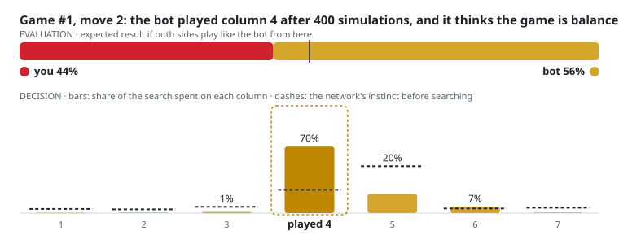
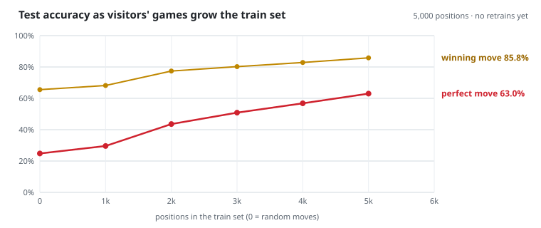

<!--- ------------------------------------------------------------------------------------------------------------------------------------------------------ -->
<!--- -- Banner + links ------------------------------------------------------------------------------------------------------------------------------------ -->
<!--- ------------------------------------------------------------------------------------------------------------------------------------------------------ -->

    <h1 align="center">
        
         
        
         
        
        
        
        
        
    </h1>

<!--- ------------------------------------------------------------------------------------------------------------------------------------------------------ -->
<!--- -- About --------------------------------------------------------------------------------------------------------------------------------------------- -->
<!--- ------------------------------------------------------------------------------------------------------------------------------------------------------ -->

I'm Pol, a software, data and ML engineer from Barcelona. I'm finishing a double degree in **Data Science & Engineering and Biomedical Engineering** at CFIS-UPC, and I've just done my second consecutive internship at **Google**.

What drives me is curiosity. I like taking a technology and pushing it until I find out what it can really do: getting Mixture-of-Experts models to run on custom AI chips, getting LLMs to write correct SQL over databases they've never seen, and, as you'll find a bit further down, turning this profile page into a machine-learning experiment you can play against.

🎯 Graduating in **June 2027** and open to **software, ML and data roles** from then on. 💬 Ask me about **ML systems, Python, data science or competitive programming**.

<!--- ------------------------------------------------------------------------------------------------------------------------------------------------------ -->
<!--- -- Tech stack ---------------------------------------------------------------------------------------------------------------------------------------- -->
<!--- ------------------------------------------------------------------------------------------------------------------------------------------------------ -->
 
<h2 align="center">🧰 What I work with 🧰</h2>
 
<table align="center">
    <thead> <tr> <th>Category</th> <th>Tools</th> </tr> </thead>
    <tbody>
        <tr><td>Languages</td><td></td></tr>
        <tr><td>Machine learning</td><td></td></tr>
        <tr><td>Databases</td><td></td></tr>
        <tr><td>Infra & web</td><td></td></tr>
        <tr><td>Workflow</td><td></td></tr>
    </tbody>
</table>

<i>Also: NumPy · pandas · LLMs · RAG · AI agents · quantization · Monte Carlo Tree Search</i>

<b>The math behind the models I work with</b> (attention and Mixture-of-Experts)

**Scaled dot-product attention**, the core of every transformer:

$$\text{Attention}(Q,K,V)=\text{softmax}\left(\frac{QK^\top}{\sqrt{d_k}}\right)V$$

**Multi-head attention**, several attention patterns learned in parallel:

$$\text{MultiHead}(Q,K,V)=\text{Concat}(\text{head}_1,\dots,\text{head}_h)\,W^O,\qquad \text{head}_i=\text{Attention}(QW_i^Q,\,KW_i^K,\,VW_i^V)$$

**Mixture-of-Experts top-k gating**, the kind of model I made run on custom AI chips at Esperanto:

$$y=\sum_{i=1}^{N} G(x)_i\,E_i(x),\qquad G(x)=\text{softmax}\big(\text{TopK}(xW_g,\,k)\big)$$

<!--- ------------------------------------------------------------------------------------------------------------------------------------------------------ -->
<!--- -- The Connect 4 experiment -------------------------------------------------------------------------------------------------------------------------- -->
<!--- ------------------------------------------------------------------------------------------------------------------------------------------------------ -->
 
<h2 align="center">🔴 The experiment: an AI that learns from you 🟡</h2>

A GitHub profile is supposed to be a static page. I wanted to see how far that could be pushed: could a README host a neural network that plays you, and that gets stronger every time someone plays it? Everything below runs on free GitHub Actions, with no server and no GPU.

The bot started deliberately weak, trained on only **5,000** positions. Every game you play gives it new positions to learn from, and a perfect Connect 4 solver checks its homework. The question is how close to perfect play the people who visit this page can push it.

### 🧮 How the bot thinks

**1. It sees the board as numbers.** A position becomes three 6×7 grids of zeros and ones: the bot's pieces, your pieces, and the cells where a piece can land.

$$s\in\lbrace 0,1\rbrace^{3\times 6\times 7}$$

**2. It has an instinct.** A residual convolutional network (6 blocks × 96 channels, 1.06M parameters) reads the grids and returns two things: a probability for each of the 7 columns, and an evaluation of who is winning.

$$f_\theta(s)=(\mathbf{p},\,v),\qquad \mathbf{p}\in[0,1]^7,\quad v\in[-1,1]$$

Each residual block learns a correction on top of what the previous block saw, which is what lets a deep network train well:

$$h_{l+1}=\mathrm{ReLU}\Big(h_l+\mathrm{BN}\big(W_2\ast\mathrm{ReLU}(\mathrm{BN}(W_1\ast h_l))\big)\Big)$$

**3. It thinks ahead.** Before every move it runs Monte Carlo Tree Search: 400 imagined continuations of the game. At each step of each one, it picks the move that best balances what has worked so far ($Q$) with what its instinct suggests ($P$) and how little it has explored that move ($N$):

$$a^\star=\arg\max_a\left[\,Q(s,a)+c_{\text{puct}}\;P(s,a)\,\frac{\sqrt{N(s)}}{1+N(s,a)}\,\right]$$

Then it plays the column it explored most.

**4. It learns from your games.** Each game adds positions from the board and from the bot's own search tree. Every night a perfect solver labels them with the best moves $\boldsymbol{\pi}$ and the true result $z$, and a GitHub Action retrains the network in PyTorch to minimise:

$$\ell(\theta)=(z-v)^2-\boldsymbol{\pi}^\top\log\mathbf{p}+c\,\lVert\theta\rVert^2$$

The first term teaches it to judge positions, the second to pick the moves a perfect player would, and the third keeps the weights small so it doesn't just memorise. A new version only goes live if it does at least as well on 10,000 test positions it never trains on.

<!-- The block below is rewritten automatically by .github/workflows/connect4-*.yml -->
<!-- C4:START -->
### ▶️ Play it

**Game #1**: your turn, you play 🔴. Click a column number to drop a piece. Last moves: @PDelos played column 6, the bot answered in column 4.

| [**1**](https://github.com/PDelos/PDelos/issues/new?title=c4%7Cmove%7C1&body=Just%20submit%20this%20issue%20as%20it%20is%2C%20no%20need%20to%20write%20anything.%20Within%20a%20minute%20a%20GitHub%20Action%20will%20make%20the%20move%2C%20the%20bot%20will%20answer%2C%20and%20the%20board%20on%20my%20profile%20will%20update.) | [**2**](https://github.com/PDelos/PDelos/issues/new?title=c4%7Cmove%7C2&body=Just%20submit%20this%20issue%20as%20it%20is%2C%20no%20need%20to%20write%20anything.%20Within%20a%20minute%20a%20GitHub%20Action%20will%20make%20the%20move%2C%20the%20bot%20will%20answer%2C%20and%20the%20board%20on%20my%20profile%20will%20update.) | [**3**](https://github.com/PDelos/PDelos/issues/new?title=c4%7Cmove%7C3&body=Just%20submit%20this%20issue%20as%20it%20is%2C%20no%20need%20to%20write%20anything.%20Within%20a%20minute%20a%20GitHub%20Action%20will%20make%20the%20move%2C%20the%20bot%20will%20answer%2C%20and%20the%20board%20on%20my%20profile%20will%20update.) | [**4**](https://github.com/PDelos/PDelos/issues/new?title=c4%7Cmove%7C4&body=Just%20submit%20this%20issue%20as%20it%20is%2C%20no%20need%20to%20write%20anything.%20Within%20a%20minute%20a%20GitHub%20Action%20will%20make%20the%20move%2C%20the%20bot%20will%20answer%2C%20and%20the%20board%20on%20my%20profile%20will%20update.) | [**5**](https://github.com/PDelos/PDelos/issues/new?title=c4%7Cmove%7C5&body=Just%20submit%20this%20issue%20as%20it%20is%2C%20no%20need%20to%20write%20anything.%20Within%20a%20minute%20a%20GitHub%20Action%20will%20make%20the%20move%2C%20the%20bot%20will%20answer%2C%20and%20the%20board%20on%20my%20profile%20will%20update.) | [**6**](https://github.com/PDelos/PDelos/issues/new?title=c4%7Cmove%7C6&body=Just%20submit%20this%20issue%20as%20it%20is%2C%20no%20need%20to%20write%20anything.%20Within%20a%20minute%20a%20GitHub%20Action%20will%20make%20the%20move%2C%20the%20bot%20will%20answer%2C%20and%20the%20board%20on%20my%20profile%20will%20update.) | [**7**](https://github.com/PDelos/PDelos/issues/new?title=c4%7Cmove%7C7&body=Just%20submit%20this%20issue%20as%20it%20is%2C%20no%20need%20to%20write%20anything.%20Within%20a%20minute%20a%20GitHub%20Action%20will%20make%20the%20move%2C%20the%20bot%20will%20answer%2C%20and%20the%20board%20on%20my%20profile%20will%20update.) |
|:-:|:-:|:-:|:-:|:-:|:-:|:-:|
| ⚪ | ⚪ | ⚪ | ⚪ | ⚪ | ⚪ | ⚪ |
| ⚪ | ⚪ | ⚪ | ⚪ | ⚪ | ⚪ | ⚪ |
| ⚪ | ⚪ | ⚪ | 🟡 | ⚪ | ⚪ | ⚪ |
| ⚪ | ⚪ | ⚪ | 🟡 | ⚪ | ⚪ | ⚪ |
| ⚪ | ⚪ | ⚪ | 🔴 | ⚪ | ⚪ | ⚪ |
| 🔴 | ⚪ | ⚪ | 🟡 | ⚪ | 🔴 | ⚪ |

**Record vs humans:** 🤖 bot 0 wins · 🧑 humans 0 wins · 🤝 0 draws (0 games) · **Most moves:** @PDelos (3)

### 🧠 What it was thinking

### 📈 How your games make it better

**Model v1** · 1.06M parameters · trained on **5,000** solver-labelled positions, **0** of them from games against visitors

| Picks… | network alone | network + tree search |
|:--|:-:|:-:|
| a perfect move (fastest win) | **63.0%** | **78.8%** |
| a winning move | **85.8%** | **93.5%** |

Measured on 10,000 fixed test positions it never trains on (tree search: 400 of them, 400 simulations each). It started at 63.0% / 85.8% on 5,000 positions; in testing, the same network trained on 110,000 positions reached 98% winning moves with search. It retrains each time the train set grows 10%.
<!-- C4:END -->

How it's built: the game runs on GitHub Issues and a GitHub Action (NumPy only, so a move takes seconds); training runs nightly in a second Action with PyTorch; the solver is written in C. The code is in the [`connect4/`](connect4) folder of this repo.

<!--- ------------------------------------------------------------------------------------------------------------------------------------------------------ -->
<!--- -- Experience ---------------------------------------------------------------------------------------------------------------------------------------- -->
<!--- ------------------------------------------------------------------------------------------------------------------------------------------------------ -->
 
<h2 align="center">💼 Experience 💼</h2>

**Site Reliability Engineer Intern · Google** · *Munich · Jul – Oct 2026* 
Built RPC endpoints inside existing binaries to make data pipelines observable, so engineers can diagnose probe configuration issues on their own. Built an agent skill wrapper for automated debugging that raised its success rate by **97%**. `C++` `SQL` `AI agents`

**Associate Software Engineer Intern · Google** · *Zurich · Jun – Sep 2025* 
Built an AI system that turns natural-language questions into SQL, using Retrieval-Augmented Generation to match user intent to the right database schemas. Cut errors and hallucinations with query validation and targeted schema context. `Python` `SQL` `LLMs` `RAG`

**Data Engineer · Esperanto Technologies** · *Barcelona · Jun – Sep 2024* 
Used PyTorch and Rust to edit Mixture-of-Experts model graphs so they ran correctly on the company's own AI chips, then sped them up with quantization and sparse execution. `PyTorch` `Rust` `Python` `C++`

**Data Scientist · Science4Tech** · *Barcelona · Jul 2023 – Apr 2024* 
Analyzed administrative, public and clinical data for oncology trials and built ML models for trial optimization, risk monitoring and efficiency prediction. `Python` `SQL` `ML`

<!--- ------------------------------------------------------------------------------------------------------------------------------------------------------ -->
<!--- -- Education, achievements, community ---------------------------------------------------------------------------------------------------------------- -->
<!--- ------------------------------------------------------------------------------------------------------------------------------------------------------ -->
 
<h2 align="center">🎓 Education & achievements 🎓</h2>

**Data Science & Engineering + Biomedical Engineering** (double degree) · CFIS, Polytechnic University of Catalonia · *expected June 2027* 
**Spanish Scientific Baccalaureate (13.167/14) + International Baccalaureate (40/45)** · INS Jaume Vicens Vives, CiMs-Cellex excellence track

🥇 1st place, **HackUPC** · 🥇 1st place, **Datathon FME** (2023) · 🥉 3rd place, **HP CodeWars Barcelona** (2022) · 🌍 Represented **Spain** at the International Informatics Olympiad in Teams (2021) · 🥉 Bronze, **BarcelonaTech Math Contest** (2021) · 🎖️ Leagues of Code scholarship (2022)

📖 Founder and lead organizer of the **UP+C Integration Bee**, a UPC integration contest inspired by MIT's, for 60+ students · 💻 Full-stack developer for the **Associació d'Estudiants de Dades** · 🧑‍🏫 Competitive programming instructor for the **Advanced Informatics Olympiad Course**

🗣️ Spanish and Catalan (native) · English (advanced) · French (basic)

<!--- ------------------------------------------------------------------------------------------------------------------------------------------------------ -->
<!--- -- Contributions + stats ----------------------------------------------------------------------------------------------------------------------------- -->
<!--- ------------------------------------------------------------------------------------------------------------------------------------------------------ -->
  

    <h2>🐍 My Contributions 🐍</h2>
     
    

  

    
    &nbsp;&nbsp;&nbsp;&nbsp;
    

