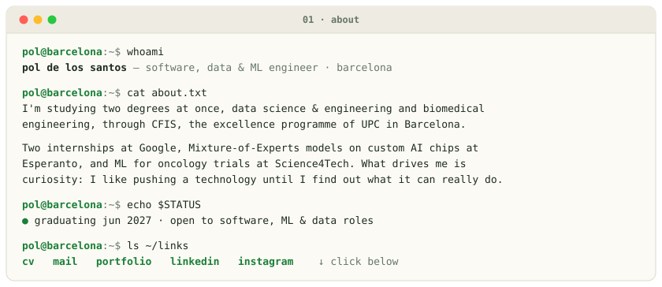
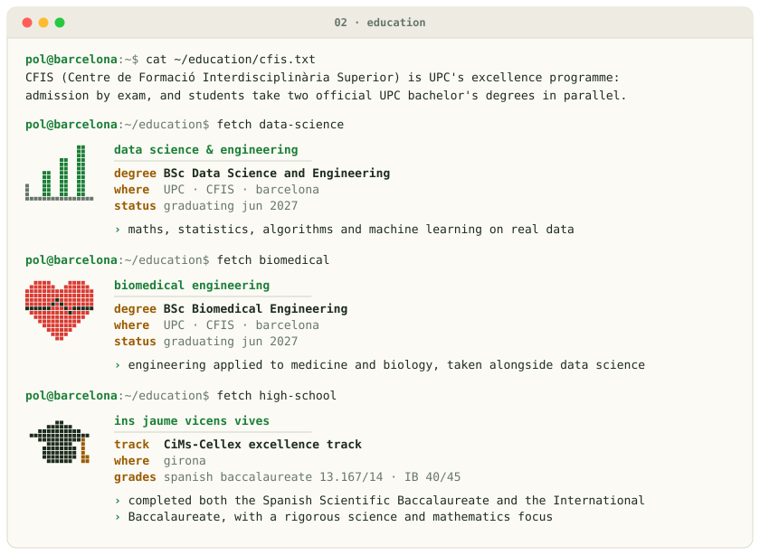
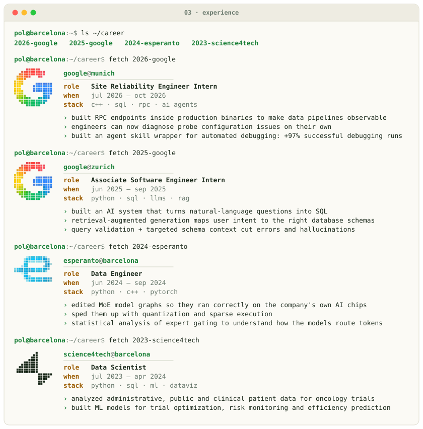
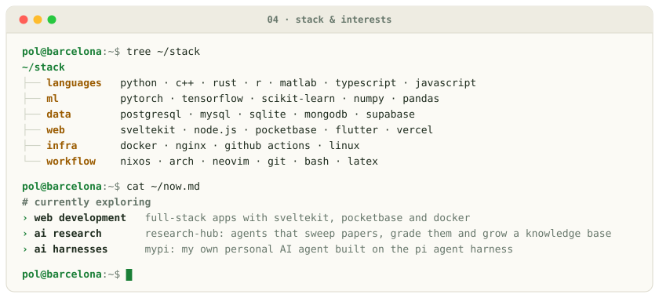

<!-- Generated by profile/build.py: edit the content there and rerun it. -->

<picture><source media="(prefers-color-scheme: dark)" srcset="assets/dark/about.svg"/></picture>

<a href="https://github.com/PDelos/PDelos/blob/main/cv/Pol_de_los_Santos_CV.pdf"><picture><source media="(prefers-color-scheme: dark)" srcset="assets/dark/link-cv.svg"/></picture></a>
<a href="mailto:delossantospol001@gmail.com"><picture><source media="(prefers-color-scheme: dark)" srcset="assets/dark/link-mail.svg"/></picture></a>
<a href="https://polsantos.com"><picture><source media="(prefers-color-scheme: dark)" srcset="assets/dark/link-portfolio.svg"/></picture></a>
<a href="https://www.linkedin.com/in/pol-de-los-santos-subirats/"><picture><source media="(prefers-color-scheme: dark)" srcset="assets/dark/link-linkedin.svg"/></picture></a>

<picture><source media="(prefers-color-scheme: dark)" srcset="assets/dark/education.svg"/></picture>

<picture><source media="(prefers-color-scheme: dark)" srcset="assets/dark/experience.svg"/></picture>

<picture><source media="(prefers-color-scheme: dark)" srcset="assets/dark/stack.svg"/></picture>

